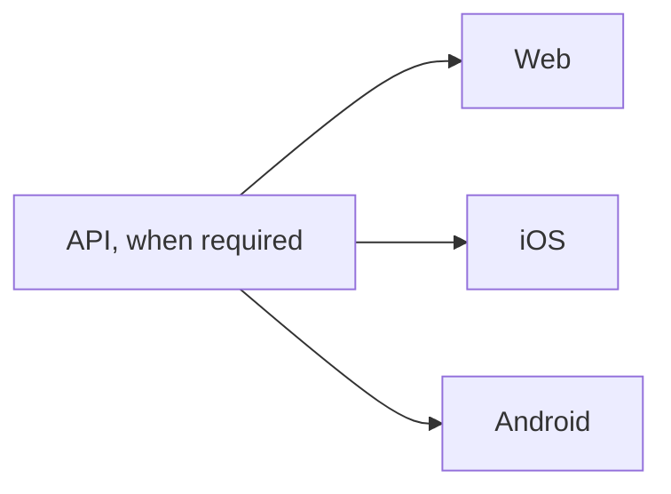

<!-- Mark uninvolved targets N/A. Link target issues as sub-issues and add dependencies where needed. -->

## Get Ready

**Coordinator:**

**Outcome shared at:**

| Target | Current version | Shipping version | Target issue |
| --- | --- | --- | --- |
| API | | | |
| Web | | | |
| iOS | | | |
| Android | | | |

- [ ] Link each target issue and add its dependencies.
- [ ] Confirm the rollout preserves compatibility with existing clients.

## Get Set

Record QA and readiness in each target issue; link the evidence here. Mark targets N/A where appropriate.

| Target | QA result / evidence | Ready to ship? | Go signal received? |
| --- | --- | --- | --- |
| API | | | |
| Web | | | |
| iOS | | | |
| Android | | | |

- [ ] Confirm each included target is ready and its Go signal is accounted for.

## Go

Ship the API first when a target depends on it; otherwise, proceed independently. Web, iOS, and Android can ship in parallel when their dependencies and gates permit.

- [ ] Confirm each dependency succeeded before starting the dependent target.
- [ ] Confirm each included target reached its finish line.
- [ ] Share the outcome and hand off remaining issues.

**Outcome:**
