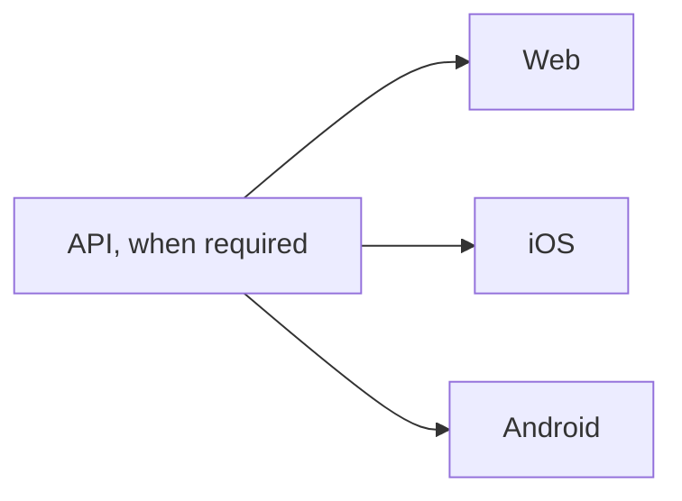

<!-- Complete the version matrix and links before shipping. Mark unaffected targets N/A. -->

## Get Ready

The finish line is reached when every included target has reached the finish line in its linked issue.

| Target | Current version | Shipping version | Target issue |
| --- | --- | --- | --- |
| API | | | |
| Web | | | |
| iOS | | | |
| Android | | | |

**Coordinator:**

**Where will the outcome be shared?**

- [ ] Create or link a target issue for each included target and record its version above.
- [ ] Confirm the API and existing clients remain compatible throughout the rollout.
- [ ] Add GitHub issue dependencies for targets that must wait for another issue to finish; use sub-issues to show which targets this shipment coordinates.

**Are we ready?**

## Get Set

- [ ] Check each included target issue and record any outstanding preparations, checks, or approvals there.
- [ ] Confirm each included target's Go signal and responsible person or system are identified in its issue.

**Are we set?**

## Go

When an API change is required by the clients, ship it first; then web, iOS, and Android can proceed in parallel as their own gates allow. Skip unaffected targets. If the API is unchanged or a target does not depend on it, that target can proceed independently.

The diagram shows the usual relationship; the actual GitHub issue dependencies are the source of truth for this shipment. Before proceeding, confirm a closed prerequisite reached its finish line: a closed issue can also represent a failed attempt.

- [ ] Start API shipping if included.
- [ ] Start web, iOS, and Android shipping as their dependencies and gates allow.
- [ ] Confirm each included target has reached its finish line in its target issue.
- [ ] Share the outcome and hand off remaining issues.

If blocked, record the blocker and how it can be resolved. If human help or a decision is required, mark the workstream hard blocked. Other targets may continue when their dependencies permit.

If the finish line changes, start over and get ready again. If a human decides this attempt cannot or should not continue, record the failure and preserve this issue as context for a new attempt.

**Outcome:**
